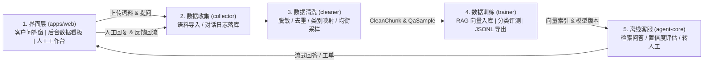

# 培训-客服系统demo 架构设计文档

> 仓库标识：`training-service-system-demo` | 开源协议：MIT | 主语言：TypeScript

---

## 1. 项目定位与核心价值

本项目为培训阶段交付的**离线中文客户问答与客服系统原型（Demo）**。

核心目标在于构建一条**端到端可运行、过程可复现、可持续迭代**的工程闭环：

```text
公开中文客服/投诉语料
  -> 数据收集与标准化清洗
  -> 样本均衡采样与确定性切分
  -> 双轨训练（RAG 向量入库 + 意图/投诉分类评测）
  -> 离线客服问答与人工接管演示
```

### 设计原则
1. **单机零外部依赖**：不依赖公有云大模型 API，不强依赖 Docker，开箱即在个人电脑离线运行。
2. **样本均衡优先**：防止“普通咨询多、投诉样本少”导致模型偏斜，清洗阶段强制执行类别统计与均衡采样。
3. **实验可复现**：所有采样、切分与训练任务必须绑定固定随机种子（`seed`）与数据集版本号（`DatasetVersion`）。
4. **可持续推进**：每次新增语料或修正坏样本（Bad Case）均生成新版本快照，支持按 `accuracy` 与 `macroF1` 纵向对比效果。

---

## 2. 硬件基线与技术栈选型

| 维度 | 选型方案 | 说明 |
| :--- | :--- | :--- |
| **运行硬件** | Mac / 个人电脑（16GB~32GB 内存） | 支持本地运行 3B~7B 量化模型 |
| **离线推理引擎** | **Ollama** | 本地 HTTP 服务；建议对话模型 `qwen2.5:3b` 或 `qwen2.5:7b`，向量模型 `nomic-embed-text` / `bge-m3` |
| **工程架构** | **npm workspaces (TypeScript Monorepo)** | 前后端与核心逻辑统一使用 TypeScript |
| **结构化存储** | **SQLite**（单文件本地数据库） | 零运维，直接随本地 `data/` 目录持久化 |
| **向量存储** | **本地文件向量库（LanceDB / 本地 JSON 索引）** | 无需 Docker，单机直接读写与检索 |
| **界面层** | **Next.js (App Router) + Tailwind CSS** | 单应用内提供“客户问答端”与“管理/人工客服后台”双视角 |

---

## 3. 数据集、样本均衡与可复现规范

### 3.1 公开中文语料来源
原型支持接入公开中文客服与投诉语料（CSV / JSONL 格式）：
- **One-of-a-kind Customer Complaint Handling (CCH)**：客户投诉案例与处理决策语料。
- **CSDS**：中文客服多轮对话与摘要数据集。
- **CCSE-CS / JDDC**：电商、快递等常见售后咨询与客诉对话语料。

### 3.2 四大核心均衡类别（`QaCategory`）
清洗阶段将原始语料映射收敛为 4 个标准类别，保证 Demo 评测清晰可控：
1. `consultation`：产品/规则/账户等普通咨询
2. `logistics`：发货、配送延迟、物流异常查询
3. `refund`：退货、换货、退款申请与进度
4. `complaint`：服务态度、商品质量、超时未处理等投诉升级场景

### 3.3 样本均衡与确定性切分规则
1. **确定性随机种子**：默认 `seed = 42`（可配置），使用确定性伪随机数生成器（PRNG）执行抽样与洗牌。
2. **均衡策略（`BalanceStrategy`）**：
   - `undersample`（默认）：以样本数最少的类别为基准，对其余类别按 `seed` 等量抽样，确保 4 类比例严格为 `1:1:1:1`。
   - `oversample` / `stratified`：作为可选策略保留，用于对比不同均衡方案对 `macroF1` 的影响。
3. **防泄露切分**：均衡后的样本按 `8:1:1`（`train / val / test`）确定性切分，并将结果固化在 `QaSample.split` 与 `DatasetVersion` 中。

---

## 4. 五大核心模块架构



### 各模块职责边界

1. **`@ts-qa/shared`（公共协议）**
   - 定义文档、清洗块、数据集版本、QA 样本、对话会话、转人工工单、训练任务与评测指标类型。
   - 代码位置：`packages/shared/src/`

2. **`@ts-qa/collector`（数据收集）**
   - 接收本地上传或脚本导入的公开 CSV/JSONL/Markdown/TXT 语料。
   - 记录原始校验和（`checksum`）防重复入库，落库为 `RawDocument`。
   - 实时采集客户提问、AI 回答与客户反馈（点赞/点踩）。

3. **`@ts-qa/cleaner`（数据清洗）**
   - **脱敏**：正则替换手机号、身份证号、邮箱、银行卡号等敏感信息，标记 `sanitized = true`。
   - **去重与过滤**：过滤空文本、纯表情或过短无效寒暄。
   - **均衡与切分**：生成 `DatasetVersion` 快照，记录各类别数量分布，输出均衡的 `QaSample` 与 `CleanChunk`。

4. **`@ts-qa/trainer`（数据训练 — 双轨演示）**
   - **轨道 A（RAG 向量入库）**：调用本地 Ollama Embedding 接口，将 `CleanChunk` 写入本地向量索引，立即服务问答。
   - **轨道 B（意图/投诉分类评测与微调导出）**：
     - 在 `test` 集上运行本地模型意图识别评测，输出 `accuracy`、`macroF1` 与各类别召回率，记录到 `TrainingJob`。
     - 导出标准指令微调格式（JSONL）至本地产物目录，供可选的外部 QLoRA 脚本训练升级。

5. **`@ts-qa/agent-core`（离线客服核心）**
   - 接收用户提问 -> 向量检索 Top-K 知识片段 -> 组装中文客服 Prompt -> 调用本地 Ollama 生成回答并附带引用（`CitationRef`）。
   - **转人工触发条件**：
     - 检索最高相似度或模型置信度低于阈值（`low_confidence`）
     - 意图判定为高风险投诉或用户明确要求转人工（`user_requested`）
     - 连续 2 轮被客户点踩（`repeated_failure`）
   - 触发后自动生成 `HandoffTicket`，会话状态切换为 `handoff_pending`，等待后台人工接管。

6. **`@ts-qa/web`（界面层 — 单应用双视角）**
   - **客户侧页面**：极简聊天窗口、展示引用来源、支持点踩/点赞与一键转人工。
   - **管理与客服侧页面**：
     - 数据集与均衡看板（展示 4 类样本柱状图与 `DatasetVersion` 记录）
     - 实验评测对比页（对比不同版本/策略的 `accuracy` 与 `macroF1`）
     - 人工客服接管台（认领 `handoff_pending` 工单并手动回复，优质回复可一键转存为新 `QaSample`）

---

## 5. 分阶段实施路线图

- **Milestone 1（已完成模型定义）**：搭建 Monorepo 骨架，完成 `@ts-qa/shared` 数据模型与设计文档。
- **Milestone 2（数据闭环）**：实现 `@ts-qa/collector` + `@ts-qa/cleaner`（含 SQLite 落库、脱敏、4 类别均衡采样、确定性切分脚本与单元测试）。
- **Milestone 3（双轨训练与离线核心）**：实现 `@ts-qa/trainer`（向量入库 + `macroF1` 评测）与 `@ts-qa/agent-core`（Ollama 问答 + 转人工状态机）。
- **Milestone 4（双视角界面与演示）**：实现 `apps/web` 客户问答端与后台工作台，跑通完整离线演示。
